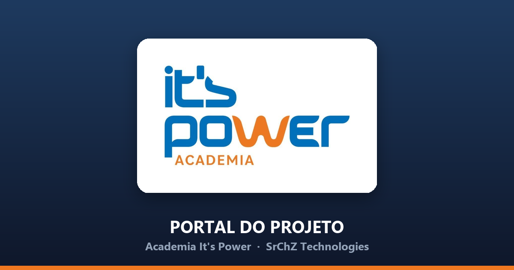

<div align="center">



# It's Power — Portal do Projeto

**Portal SaaS de gestão de conteúdo digital** para a Academia It's Power (Cláudio/MG), desenvolvido pela [SrChZ Technologies](https://github.com/WebSrChZ) — CNPJ 68.371.698/0001-95.

[](https://websrchz.github.io/its-power-hub/)
&nbsp;


</div>

---

## Sobre

Painel onde a agência e o cliente acompanham o projeto de conteúdo da academia em um só lugar: **calendário editorial**, **roteiros detalhados** de cada vídeo, **feedback em tempo real**, **métricas do Instagram** e **acompanhamento de fases**. Construído como SPA estática (sem build step) com backend Supabase, e publicado automaticamente no GitHub Pages.

## Recursos

- 📅 **Calendário editorial** — 12 vídeos/mês por mês, cobrindo os 8 pilares de conteúdo, com status de produção por post
- 🎬 **Roteiros completos** — cortes cena a cena, legendas e ideias de stories de cada vídeo (jun/jul/ago)
- ⭐ **Feedback do cliente** — avaliação por estrelas e observações, sincronizados em tempo real
- 🔔 **Notificações realtime** — pedidos, mudanças de status e atividade via Supabase Realtime
- 🔄 **Sincronização multi-device** — status, fase, anotações e checklist de cada roteiro espelhados entre portal e dispositivos em tempo real
- 📊 **Resultados** — métricas de desempenho do Instagram das duas unidades
- 🔐 **Acesso autenticado** + consentimento **LGPD** persistente
- 📱 **PWA instalável** — ícones maskable, modo standalone, offline com service worker
- 🌗 **Dark mode** e layout responsivo mobile-first

## Stack & Arquitetura

```
Front-end   HTML + CSS + JavaScript vanilla (sem framework, sem build)
Backend     Supabase (Postgres, Auth via RPC, Realtime)
Hospedagem  GitHub Pages
CI/CD       GitHub Actions → checks em todo PR + deploy automático no push na master
PWA         manifest + service worker (stale-while-revalidate)
```

A pasta `public/` é publicada como está — o que está no repositório é exatamente o que vai ao ar.

## Modelo de acesso

O portal é estático e fala direto com o Supabase. A `anon key` em `public/js/api.js`
é **pública por natureza** — está no repositório e no DevTools de qualquer visitante —
então ela não protege nada. Toda a proteção real vive no banco:

| Camada | Onde | O que garante |
|---|---|---|
| RLS por operação | `supabase_hardening_001.sql` | `anon` não tem `DELETE` em nenhuma tabela |
| Token de sessão | `verify_login` → `portal_sessions` | sessão com validade (12 h), verificável no servidor |
| RPC de admin | `admin_delete_*` | remoção exige token de admin válido, checado no Postgres |
| RPC de LGPD | `lgpd_status` / `lgpd_accept` | dado pessoal fora do alcance direto do cliente |

`Auth.isAdmin()` no front-end serve **apenas para mostrar/esconder controles**. Não é
uma fronteira de segurança: quem edita o `sessionStorage` muda o que aparece na tela,
mas não consegue apagar nada sem um token de admin emitido pelo servidor.

**Escrita anônima: fechada** pelo par 002a + 002b. Toda escrita exige um token
de sessão emitido por `verify_login` (12 h de validade), e remoção e entrada de
métricas exigem papel de admin — verificado no Postgres.

**`SELECT` segue liberado** para `anon` nas tabelas de conteúdo, e isso é
deliberado: é a permissão que o Realtime usa para entregar `postgres_changes`,
que é o que sincroniza o portal entre dispositivos. Fechar a leitura exigiria
trocar o Realtime por polling autenticado. As tabelas com dado pessoal
(`lgpd_consent`, `portal_users`, `portal_sessions`) estão fechadas também para
leitura.

### O repositório não descrevia a produção

Até 2026-10-17 os arquivos `.sql` daqui não registravam uma camada de
autorização que existia em produção desde 2026-06-30. A auditoria de agosto leu
o repositório, com o banco pausado, e concluiu errado sobre o estado do banco.

**[`SCHEMA.md`](SCHEMA.md)** documenta o que a produção realmente tem, lido dos
catálogos. As consultas que o geram estão em `tools/inspect_schema.sql` — vale
rodar depois de qualquer pausa/restauração do projeto, que foi o que derrubou a
publicação do Realtime sem nenhum sintoma além de "o portal não atualiza mais
sozinho".

### Ordem de execução do SQL

A ordem importa: um dos arquivos remove permissão e quebra o portal se rodar
cedo.

```
1) supabase_setup.sql                        schema
2) supabase_hardening_001.sql                policies, sessões, LGPD
3) supabase_realtime_001.sql                 recoloca as tabelas na publicação
4) supabase_hardening_002a_rpc_sessao.sql    escritas via RPC com token  (aditivo)
   ↓  merge + deploy: o front-end passa a chamar as RPCs
5) supabase_hardening_002b_fecha_escrita_anon.sql   fecha a escrita anônima
```

O **002b é o único que remove permissão.** Rodá-lo antes do deploy do passo
intermediário faz toda escrita do portal falhar: o front-end antigo grava
direto na tabela com a anon key. O 002a é aditivo e pode rodar com o portal
velho no ar.

## Estrutura

```
public/
├── index.html                       Portal (landing + auth + abas)
├── css/styles.css                   Estilos, dark mode, responsivo
├── js/
│   ├── app.js                       Dados, render, realtime, LGPD, export PDF
│   ├── api.js                       Cliente Supabase
│   ├── auth.js                      Login (RPC) + sessão
│   └── router.js                    Navegação por abas (hash)
├── its_power_videos_*2026.html      Páginas de roteiros (jun/jul/ago)
├── manifest.json · sw.js            PWA
└── assets/                          Logo, ícones, og-image
SCHEMA.md                            O que a produção realmente tem
supabase_setup.sql                   Schema do backend (referência)
supabase_hardening_001.sql           Policies, sessões e RPCs de admin
supabase_realtime_001.sql            Tabelas na publicação do Realtime
supabase_hardening_002a_rpc_sessao.sql          Escritas via RPC (aditivo)
supabase_hardening_002b_fecha_escrita_anon.sql  Fecha escrita anônima (só pós-deploy)
tools/check_site.py                  Verificação estática (roda no CI)
tools/inspect_schema.sql             Consultas que geram o SCHEMA.md
.github/workflows/deploy.yml         Deploy GitHub Pages
```

## Verificação antes do merge

O deploy publica `public/` como está — um merge com link morto vai direto para
o portal do cliente, e o workflow de deploy só roda **depois**, no push para
`master`. O `.github/workflows/pr-checks.yml` roda antes, em todo PR:

| Check | Barra |
|---|---|
| `tools/check_site.py public` | HTML malformado, JSON-LD inválido, link ou asset interno inexistente |
| `node --check` | erro de sintaxe em qualquer JS de `public/` |
| bump de cache | alteração em `public/{index.html,css,js}` sem bump do `sw.js` |
| sincronia de versão | `?v=` dos assets divergindo do `CACHE_NAME` |

Localmente:

```bash
python3 tools/check_site.py public
```

## Desenvolvimento local

Não há build — basta servir a pasta `public/`:

```bash
python -m http.server 8000 --directory public
# abra http://localhost:8000
```

As credenciais do Supabase no front-end são a `anon key` pública (protegida por RLS no banco).

## Deploy

Push na `master` → GitHub Actions publica no GitHub Pages (~1 min). Como há service worker, a versão de cache (`CACHE_NAME` + os `?v=` dos assets) deve ser bumpada junto para o deploy chegar aos usuários — use o helper:

```bash
./bump-cache.sh          # versão automática AAAAMMDD-<sha-curto>
```

## Status

🟢 Em produção · deploy contínuo na branch `master`.

---

<div align="center">
<sub>© 2026 SrChZ Technologies · CNPJ 68.371.698/0001-95 — projeto proprietário de cliente. Todos os direitos reservados.</sub>
</div>
